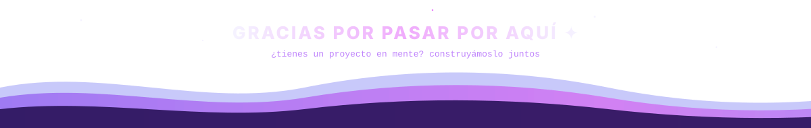

 

  

<table align="center">
<tr>
<td width="50%" valign="top">

** Lo que hago**

- Llevo productos web **de la idea a producción**: diseño, frontend, backend, base de datos y despliegue.
- Hago interfaces **animadas, rápidas y accesibles**, de las que se quedan en la memoria.
- Construyo APIs **seguras y probadas**: OWASP, RBAC, pruebas automatizadas y CI/CD.

</td>
<td width="50%" valign="top">

** Ahora mismo**

-  Desarrollando la plataforma del **Foro Interuniversitario de Posgrado**
-  Perito Técnico en Informática — **Kinal**
-  **Disponible** para freelance y trabajo remoto
-  Ciudad de Guatemala · GMT-6

</td>
</tr>
</table>

<b>FRONTEND</b> 

<b>BACKEND · DATOS</b> 

<b>DEVOPS · CALIDAD · DISEÑO</b> 

  

 

| | Proyecto | Qué es | Stack |
|:-:|---|---|---|
|  | [**Sistema Bancario**](https://github.com/rcana-2021639/grupo6-sistema-bancario-Frontend) | Banca en línea web + app móvil + microservicio de autenticación | React · React Native · Node.js · JWT · MongoDB |
|  | [**Portafolio Web**](https://github.com/rcana-2021639/PORTAFOLIO-WEB) | Mi portafolio con estética neón, GSAP y fondos WebGL | React · GSAP · OGL |
|  | [**Amaranto**](https://github.com/rcana-2021639/amaranto) | Historial médico unificado con acceso de emergencia por QR *(en desarrollo)* | TypeScript |
|  | [**J.A.R.V.I.S.**](https://github.com/rcana-2021639/JARVIS) | Asistente personal por voz con interfaz 3D *(en construcción)* | Python |

> [!NOTE]
> El código del Foro vive en un repositorio privado. Con gusto lo muestro en una llamada.

<picture>
  <source media="(prefers-color-scheme: dark)" srcset="https://raw.githubusercontent.com/rcana-2021639/rcana-2021639/output/snake-dark.svg"/>
  <source media="(prefers-color-scheme: light)" srcset="https://raw.githubusercontent.com/rcana-2021639/rcana-2021639/output/snake-light.svg"/>
  
</picture>

**¿Tienes un proyecto, una vacante remota o una idea loca?** Escríbeme, respondo rápido.

